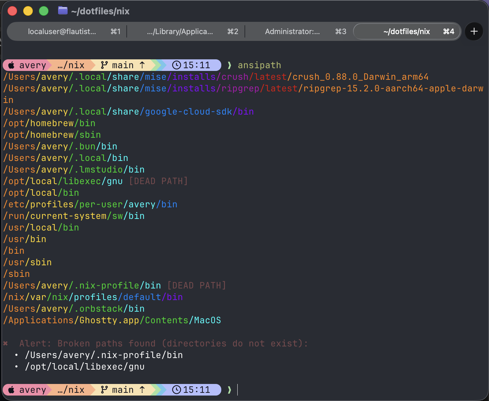

# ansipath 🌈

`ansipath` makes `$PATH` legible: each entry is printed on its own line with
colors based on directory depth, duplicate entries are highlighted, and dead
directories are called out.

## Features

- A portable Go binary with no runtime dependencies.
- Colorized `$PATH` output and duplicate/dead-path diagnostics.
- Palette switching stored under `$XDG_STATE_HOME/ansipath` (or
  `$HOME/.local/state/ansipath`).
- Bash and Zsh `pathmunge` and `which` helpers.
- Shell-init rewriting for `.bashrc`, `.bash_profile`, `.profile`, `.zprofile`,
  and `.zshrc`.

## Quick start

```sh
go build -trimpath -o ansipath .
./ansipath install
ansipath
```

For a system installation, use `sudo ./ansipath install`. The installer uses
`SUDO_USER` to update that user’s shell files while installing the binary under
`/usr/bin`.

## Commands

```sh
ansipath                 # render the current PATH
ansipath --help          # show all commands
ansipath palette list    # list palettes
ansipath palette dracula # select a palette
ansipath remove-dupes    # clean shell-init PATH assignments
ansipath remove-dupes --env
```

`remove-dupes` prints an audit trail and asks `Undo? N/y`; answering `y`
restores the original shell files. To clean the current shell as well, run:

```sh
eval "$(ansipath remove-dupes --env)"
```

The `--env` form emits sourceable removal commands and ends with an explicit
cleaned export. That final export is copied automatically when a supported
clipboard utility is available.


